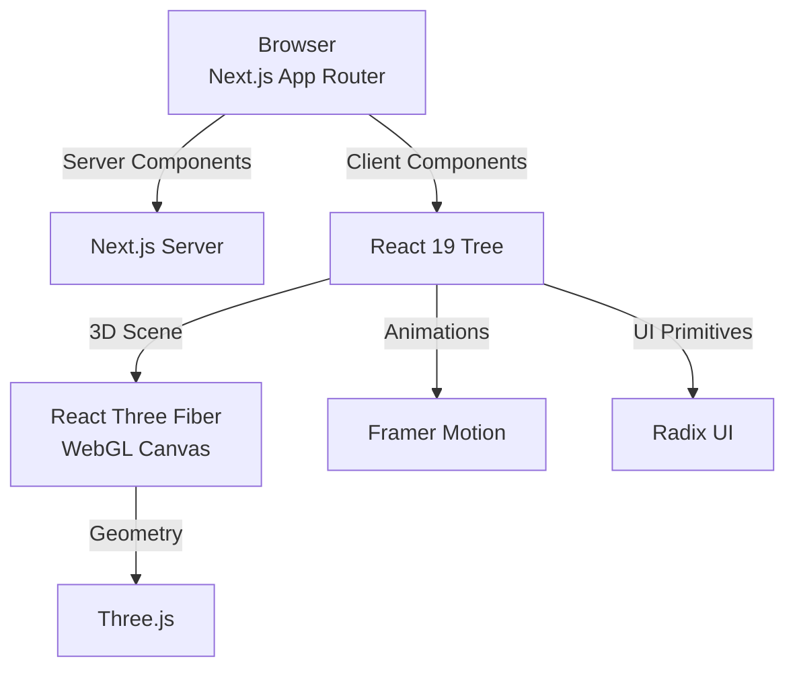

<div align="center">

# 🌌 Zenith

**A modern, interactive developer portfolio built with Next.js 16, React 19, and Three.js.**

[](https://portfolio-rouge-five-85.vercel.app)
[](./LICENSE)

[](https://nextjs.org)
[](https://react.dev)
[](https://www.typescriptlang.org)
[](https://tailwindcss.com)
[](https://threejs.org)

<!-- TODO: replace with a hero screenshot of your portfolio -->
<!--  -->

[**Live demo**](https://portfolio-rouge-five-85.vercel.app) · [**Architecture**](#architecture) · [**Quick start**](#quick-start)

</div>

---

## Overview

|  |  |
| :--- | :--- |
| **What** | A personal portfolio for Shaurya Chahal, a Full-Stack Web Developer & AI Engineer. It features a WebGL hero section, a detailed project case study (World Clock), and full dark/light mode support. |
| **Why it's interesting** | The background isn't an image—it's a real-time Three.js scene with a refractive crystal (`MeshTransmissionMaterial`) and a wireframe shell. The site is built with strict accessibility (keyboard navigation, focus rings, reduced-motion support) and a fully automated CI pipeline. |
| **Stack** | Next.js 16 (App Router) · React 19 · TypeScript (strict) · Tailwind CSS v4 · Framer Motion · Three.js / React Three Fiber · Radix UI · Lucide Icons |

## Contents

- [Demo](#demo)
- [Highlights](#highlights)
- [Architecture](#architecture)
- [Core guarantees](#core-guarantees)
- [Design decisions](#design-decisions)
- [Feature deep dives](#feature-deep-dives)
- [Quick start](#quick-start)
- [Scripts](#scripts)
- [Project structure](#project-structure)
- [Deployment](#deployment)
- [Known limitations](#known-limitations)
- [License](#license)

---

## Demo

|  |  |
| :--- | :--- |
| **Live app** | [portfolio-rouge-five-85.vercel.app](https://portfolio-rouge-five-85.vercel.app) |

<!-- TODO: add real screenshots to a docs/assets/ folder and uncomment
| Hero Section | World Clock Case Study |
| :---: | :---: |
|  |  |
-->

---

## Highlights

- **Interactive 3D Hero.** A low-poly icosahedron rendered with `MeshTransmissionMaterial` for real refraction, floating above a contact shadow. It reacts to the user's system theme (dark/light mode) and uses a custom wireframe "echo" shell for parallax depth.
- **Deep-dive case studies.** Features an in-depth look at the *World Clock* project, complete with a screenshot carousel, video walkthrough, engineering notes, and verified proof (test coverage, Lighthouse scores).
- **Accessible by design.** The custom lightbox and screenshot carousel support full keyboard navigation (`Escape`, `ArrowLeft`, `ArrowRight`, `Home`, `End`), trap focus correctly, and respect `prefers-reduced-motion`.
- **Zero layout shift theme toggling.** Uses `next-themes` with a deferred mount pattern to prevent hydration mismatches and flashing during server-side rendering.
- **Modern CSS variables.** Uses Tailwind v4 and OKLCH color space for perceptually uniform, accessible colors across both themes.
- **Automated CI.** GitHub Actions pipeline verifies strict type-checking (`tsc`), ESLint, and Next.js production builds on every push.

---

## Architecture

The portfolio uses the Next.js App Router, separating server components from heavy client-side WebGL interactions.



### Design principles

1. **Client-side isolation for WebGL.** The Three.js `<Canvas>` is wrapped in a mounted check and `Suspense` boundary so the heavy WebGL initialization never blocks the initial server render or causes hydration mismatches.
2. **Content as data.** Project case studies, stack lists, and feature grids are defined as strict TypeScript arrays at the top of their respective files, keeping components clean and content easy to update.
3. **Fail gracefully.** If an image fails to load in the carousel or lightbox, a placeholder with the image path (in dev mode) renders instead of breaking the layout.

---

## Core guarantees

| Guarantee | Mechanism |
| :--- | :--- |
| Strict type safety | `tsc --noEmit` runs in CI; all components use strict TypeScript interfaces |
| Accessible modals | `Lightbox` component locks body scroll, traps focus, and restores focus on close |
| No hydration mismatch | WebGL canvas and theme icons defer rendering until the `useEffect` mount phase |
| Zero build failures | GitHub Actions runs ESLint, `tsc`, and `next build` on every PR to `main` |
| Respects motion preferences | `useReducedMotion` from Framer Motion is checked before sliding elements or fading the lightbox |

---

## Design decisions

| Decision | Why | Trade-off |
| :--- | :--- | :--- |
| **`next-themes` with deferred mount** | Prevents the server from guessing the user's theme, which causes the "flash of incorrect theme" on load | Briefly renders a skeleton or default background on initial load |
| **React Three Fiber over raw Three.js** | Allows the 3D scene to share state (like the active theme) with React without prop drilling through context bridges | Adds a small bundle size overhead for the reconciler |
| **Tailwind v4 + OKLCH** | OKLCH provides perceptually uniform color matching. Dark mode primary colors look identical in perceived brightness to light mode. | Slightly harder to hand-pick hex codes; requires modern browsers |
| **Framer Motion for layout** | `LayoutGroup` and `AnimatePresence` make the image carousel and lightbox transitions effortless to orchestrate. | Adds ~30kb to the bundle |
| **GitHub Actions CI** | Catches type errors and build-breaking changes before Vercel deploys them. | Adds a few minutes to the PR review process |

---

## Feature deep dives

<details>
<summary><strong>🔮 The 3D WebGL Scene</strong></summary>

The `HeroCanvas` and `ZenithObject` components make up the background of the landing page.

- **`HeroCanvas`**: Sets up the `<Canvas>`, camera (`fov: 35`, `z: 4.5`), and lighting. It listens to `next-themes` to adjust ambient light and point light colors (indigo for dark mode, amber for light mode).
- **`ZenithObject`**: The core crystal. It uses `MeshTransmissionMaterial` with `transmission={0.95}` and `ior={1.4}` to simulate real glass refraction.
- **The Wireframe**: Extracts edges from `IcosahedronGeometry` using `THREE.EdgesGeometry` and renders it with `lineSegments`. The wireframe rotates in the opposite direction of the crystal for a parallax depth effect.

</details>

<details>
<summary><strong>🖼️ The World Clock Case Study</strong></summary>

The portfolio features a full engineering case study of the *World Clock* project (`src/components/projects/world-clock.tsx`).

- **Content-driven**: The entire section (screenshots, features, stats, proof) is defined at the top of the file as TypeScript constants.
- **Carousel**: Uses Framer Motion `drag="x"` for swipe support on mobile, and `ArrowLeft`/`ArrowRight` for keyboard users.
- **Lightbox**: A custom full-screen image viewer that unifies the carousel images and the "Verified" proof images into a single navigable array.
- **Resilience**: Both the carousel slides and the proof cards have `onError` handlers on their `next/image` components that swap in a fallback UI.

</details>

---

## Quick start

**Prerequisites:** Node.js 20.19+, npm.

```bash
git clone https://github.com/shaurya-10000/portfolio.git
cd portfolio
npm install
```

Start the development server:

```bash
npm run dev
```

Open [http://localhost:3000](http://localhost:3000).

## Scripts

| Command | Purpose |
| :--- | :--- |
| `npm run dev` | Development server |
| `npm run build` | Production build |
| `npm run start` | Serve the production build |
| `npm run lint` | ESLint |

Pre-flight check before pushing (runs automatically in CI):

```bash
npm run lint && npx tsc --noEmit && npm run build
```

## Project structure

```text
.
├── .github/
│   └── workflows/
│       └── ci.yml                # GitHub Actions: Lint, Typecheck, Build
├── public/                       # Static assets, images, video
├── src/
│   ├── app/
│   │   ├── layout.tsx            # Root layout: fonts, metadata, theme provider
│   │   ├── page.tsx              # Main landing page (Hero, About, Projects)
│   │   └── globals.css           # Tailwind v4 config, OKLCH tokens
│   ├── components/
│   │   ├── projects/
│   │   │   └── world-clock.tsx   # Deep-dive case study component
│   │   ├── about-card.tsx        # Identity & tech stack cards
│   │   ├── brand-icons.tsx       # SVG icons (GitHub, LinkedIn)
│   │   ├── card.tsx              # Base Card UI primitive
│   │   ├── footer.tsx
│   │   ├── header.tsx
│   │   ├── hero-canvas.tsx       # Three.js Canvas wrapper
│   │   ├── settings-menu.tsx     # Theme toggle dropdown
│   │   ├── theme-provider.tsx    # Next-themes wrapper
│   │   ├── ui.tsx                # Shadcn-style UI primitives (Button, Dropdown)
│   │   └── zenith-object.tsx     # The 3D crystal object
│   └── lib/
│       └── utils.ts              # cn() utility for Tailwind merging
├── package.json
└── tsconfig.json
```

## Deployment

### Vercel (app)

1. Push to GitHub.
2. Import the repo at [vercel.com/new](https://vercel.com/new).
3. Framework Preset: **Next.js**. Root Directory: `./`
4. Deploy.

**Production URL:** [portfolio-rouge-five-85.vercel.app](https://portfolio-rouge-five-85.vercel.app)

### CI/CD (GitHub Actions)

The `.github/workflows/ci.yml` file ensures no broken code reaches production:

1. Checks out the repository.
2. Sets up Node.js 20 with npm caching.
3. Runs `npm ci` for a clean, lockfile-accurate install.
4. Runs `npm run lint` (ESLint).
5. Runs `npx tsc --noEmit` (TypeScript strict check).
6. Runs `npm run build` (Next.js production build).

## Known limitations

- **WebGL Support:** The 3D crystal relies on WebGL. On extremely old browsers or devices with hardware acceleration disabled, the background will gracefully fall back to a solid color, but the 3D effect will be missing.
- **Mobile Performance:** To keep the mobile experience smooth, the DPR (device pixel ratio) is clamped to `[1, 2]`. High-end 4K screens might see slightly softer WebGL edges.
- **Placeholder Links:** Ensure the `/resume.pdf` link in `about-card.tsx` and the video source in `world-clock.tsx` are updated with your actual files before going live.

## License

Released under the MIT license. See [LICENSE](./LICENSE).

---

<div align="center">

**Zenith** · built by [@shaurya-10000](https://github.com/shaurya-10000)

</div>