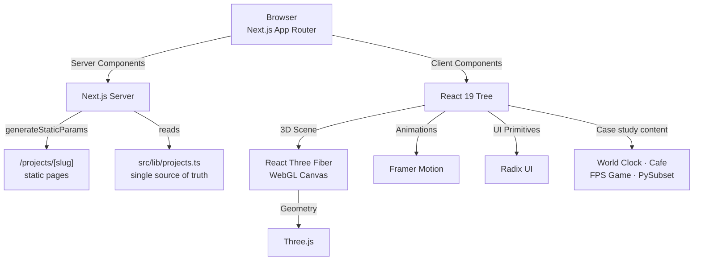

<div align="center">

# 🌌 Zenith

**A developer portfolio built with Next.js 16, React 19, and Three.js — five project case studies, a 3D hero, and a content-driven architecture.**

[](https://portfolio-rouge-five-85.vercel.app)
[](./LICENSE)

[](https://nextjs.org)
[](https://react.dev)
[](https://www.typescriptlang.org)
[](https://tailwindcss.com)
[](https://threejs.org)

[**Live demo**](https://portfolio-rouge-five-85.vercel.app) · [**Architecture**](#architecture) · [**Quick start**](#quick-start)

</div>

---

## Overview

|  |  |
| :--- | :--- |
| **What** | A personal portfolio for Shaurya Chahal, a Full-Stack Web Developer & AI Engineer. A WebGL hero, a filterable project index, and five full engineering case studies — each with a screenshot carousel, walkthrough video, feature grid, engineering notes, and verified proof. |
| **Why it's interesting** | The background isn't an image — it's a real-time Three.js scene with a refractive crystal (`MeshTransmissionMaterial`) and a wireframe shell. The project index is driven by a single typed data file, and every case study page is statically generated from it. Everything is built for strict accessibility (keyboard nav, focus rings, reduced-motion) and a fully automated CI pipeline. |
| **Stack** | Next.js 16 (App Router) · React 19 · TypeScript (strict) · Tailwind CSS v4 · Framer Motion · Three.js / React Three Fiber · Radix UI · Lucide Icons |

## Contents

- [Demo](#demo)
- [Highlights](#highlights)
- [Architecture](#architecture)
- [Core guarantees](#core-guarantees)
- [Design decisions](#design-decisions)
- [Project index](#project-index)
- [Feature deep dives](#feature-deep-dives)
- [Quick start](#quick-start)
- [Scripts](#scripts)
- [Project structure](#project-structure)
- [Deployment](#deployment)
- [Known limitations](#known-limitations)
- [License](#license)

---

## Demo

|  |  |
| :--- | :--- |
| **Live app** | [portfolio-rouge-five-85.vercel.app](https://portfolio-rouge-five-85.vercel.app) |
| **Home** | Hero → About → filterable Projects grid → Footer |
| **Case studies** | `/projects/world-clock`, `/projects/cafe`, `/projects/fps-game`, `/projects/pysubset-interpreter` |

> The FPS Game Database project has two sections (`fps-game` and `fps-game-web`) rendered on the same `/projects/fps-game` page — a backend repo and its paired frontend.

---

## Highlights

- **Interactive 3D hero.** A low-poly icosahedron rendered with `MeshTransmissionMaterial` for real refraction, floating above a contact shadow. It reacts to the active theme and uses a counter-rotating wireframe "echo" shell for parallax depth. Automatically skipped on phones, reduced-motion, Data Saver, and low-core devices.
- **Five deep-dive case studies.** World Clock, Cafe, FPS Game Database (+ Web), and PySubset Interpreter — each with a screenshot carousel, video walkthrough, headline metrics, feature grid, engineering notes, and verified proof (tests, coverage, Lighthouse).
- **Content as data.** `src/lib/projects.ts` is the single source of truth for the project index. Adding an entry there makes it appear in the grid, the filter tabs, the next/previous navigation, and at its own `/projects/<slug>` URL — no other file changes required.
- **Accessible by design.** Custom lightbox and carousels support full keyboard navigation (`Escape`, `←`, `→`, `Home`, `End`), lock body scroll while open, and respect `prefers-reduced-motion` throughout.
- **Graceful media failures.** Every `next/image` slide and proof card has an `onError` handler that swaps in a labelled placeholder (with the expected `public/` path shown in dev). Every `<video>` falls back to a link to the live demo or source.
- **Zero-flash theming.** `next-themes` with a deferred-mount pattern to prevent hydration mismatches, plus OKLCH design tokens in Tailwind v4 for perceptually uniform light/dark colors.

---

## Architecture

The portfolio uses the Next.js App Router, splitting static content from heavy client-side WebGL and interactive components.



### Design principles

1. **Client-side isolation for WebGL.** The Three.js `<Canvas>` is behind a mounted check and deferred to an idle callback, so heavy WebGL init never blocks first paint or causes hydration mismatches.
2. **Content as data.** `src/lib/projects.ts` owns the project index; each case study's `SCREENSHOTS`, `STATS`, `FEATURES`, `ENGINEERING_NOTES`, `TAGS`, and `PROOF` arrays live at the top of their component file. Editing content never requires touching layout.
3. **Fail gracefully.** Failed images render a placeholder with the expected path (in dev). Failed videos render a link to the live demo or source repo. Unavailable WebGL falls back to a static gradient.

---

## Core guarantees

| Guarantee | Mechanism |
| :--- | :--- |
| Strict type safety | `tsc --noEmit` runs in CI; project index types are exhaustive (`ProjectCategory`, `ProjectSectionKey`) |
| Accessible modals | `Lightbox` locks body scroll, focuses the close button on open, restores on close, and handles `Escape`/arrows/`Home`/`End` |
| Keyboard-navigable carousels | Each carousel is focusable, supports arrow keys, `Home`/`End`, `Enter` to open the lightbox, and drag-to-swipe on touch |
| No hydration mismatch | WebGL canvas and theme-dependent icons defer rendering until the mount phase |
| Zero build failures | GitHub Actions runs ESLint, `tsc --noEmit`, and `next build` on every push |
| Respects motion preferences | `useReducedMotion` is checked before sliding, fading, or auto-playing video |

---

## Design decisions

| Decision | Why | Trade-off |
| :--- | :--- | :--- |
| **Single project index (`src/lib/projects.ts`)** | One file drives the grid, filters, static params, metadata, and prev/next nav. Adding a project is a one-file change. | The index and the case study component have to stay in sync by hand (a `ProjectSectionKey` union catches typos). |
| **`next-themes` with deferred mount** | Prevents a flash of incorrect theme on load. | Briefly renders the default background before the resolved theme applies. |
| **React Three Fiber over raw Three.js** | Shares theme state with React without context bridges. | Small bundle overhead for the reconciler. |
| **`LazyMotion` + `domAnimation`** | Keeps the Framer Motion feature bundle out of the main chunk; loaded after first paint. | A short delay before the About card animates in. |
| **Tailwind v4 + OKLCH** | Perceptually uniform colors across themes. | Requires modern browsers; harder to hand-pick hex values. |
| **`generateStaticParams` + `dynamicParams = false`** | Every case study page is statically generated at build time. | Adding a project requires a rebuild (already true for Vercel deployments). |

---

## Project index

| Slug | Title | Category | Sections rendered |
| :--- | :--- | :--- | :--- |
| `world-clock` | World Clock | Frontend | `world-clock` |
| `cafe` | Cafe | Full-stack | `cafe` |
| `fps-game` | FPS Game Database | Full-stack | `fps-game`, `fps-game-web` |
| `pysubset-interpreter` | PySubset Interpreter | Languages | `pysubset-interpreter` |

The **filter tabs** on the home page are derived from the categories that actually exist (`activeCategories()`), so a category with no projects never shows an empty tab.

To add a project:

1. Add an entry to `PROJECTS` in `src/lib/projects.ts` with a new `slug` and its `sections`.
2. Create `src/components/projects/<slug>.tsx` exporting a component (see any existing case study for the pattern).
3. Add the section key to the `ProjectSectionKey` union and a `case` to `renderSection()` in `src/app/projects/[slug]/page.tsx`.

---

## Feature deep dives

<details>
<summary><strong>🔮 The 3D WebGL Scene</strong></summary>

`HeroCanvas` and `ZenithObject` make up the background of the landing page.

- **`HeroCanvas`** sets up the `<Canvas>`, camera (`fov: 35`, `z: 4.5`), and lighting. It reads `next-themes` to swap ambient/point-light colors (indigo for dark, amber for light). A `<PerformanceMonitor>` drops DPR from 1.5 to 1 if the device can't keep up.
- **Lighting** is a tuned three-source setup: ambient floor, a top-right directional key, and a bottom-left colored rim. A `<Environment>` is built from procedural `<Lightformer>` rectangles and a ring — no HDR download, no third-party request.
- **`ZenithObject`** is the crystal itself: `MeshTransmissionMaterial` with `transmission={0.95}`, `ior={1.4}`, `backside`, and low sample/resolution counts (the material re-renders the scene into an offscreen buffer every frame; above these values the visual difference is negligible).
- **The wireframe echo** extracts `THREE.EdgesGeometry` from a slightly larger icosahedron and counter-rotates it for parallax depth.
- **`shouldRender3D()` in `app/page.tsx`** skips the whole scene on phones, `prefers-reduced-motion`, low-core devices, and `navigator.connection.saveData`.

</details>

<details>
<summary><strong>🗂️ The project index and case study pattern</strong></summary>

The index (`src/lib/projects.ts`) exports:

- `PROJECTS` — the ordered list (order drives prev/next nav).
- `CATEGORY_LABEL` — display names for the filter tabs.
- `activeCategories()` — the categories that exist, in a fixed display order.
- `getProject(slug)` and `projectNeighbours(slug)` — lookups used by the route.

Each case study component (`world-clock.tsx`, `cafe.tsx`, `fps-game.tsx`, `fps-game-web.tsx`, `pysubset-interpreter.tsx`) follows the same layout:

1. **Content block** — `LINKS`, `VIDEO`, `SCREENSHOTS`, `STATS`, `FEATURES`, `ENGINEERING_NOTES`, `TAGS`, `PROOF` as typed `as const` arrays at the top.
2. **`Lightbox`** — a full-screen viewer that accepts a combined `SCREENSHOTS + PROOF` array, so carousel slides and proof cards share one navigable set.
3. **`ScreenshotCarousel`** — Framer Motion `drag="x"`, arrow keys, dot indicators with `aria-current`, and a live-region caption.
4. **`DemoVideo`** — intersection-observed; autoplays muted when 40% visible, pauses off-screen, and stops entirely under reduced-motion.
5. **`ProofCard`** — image with `onError` fallback, plus a full-screen expand button.
6. **`ProjectSection`** — reveal animations on scroll, headline metrics, feature grid, engineering notes, verified proof, tech tags, and a README link.

</details>

<details>
<summary><strong>🧭 Routing, metadata, and sitemap</strong></summary>

- `/projects/[slug]` uses `generateStaticParams()` + `dynamicParams = false`, so all pages are pre-rendered at build time.
- `generateMetadata()` pulls `title` and `description` from the project entry.
- `ProjectPageShell` renders the back bar, the sections, and a prev/next nav (falling back to "All projects" at the end).
- `sitemap.ts` and `robots.ts` both reference `SITE_URL` from `src/lib/site.ts`, which defaults to the production Vercel URL and can be overridden with `NEXT_PUBLIC_SITE_URL`.

</details>

---

## Quick start

**Prerequisites:** Node.js 20.19+, npm.

```bash
git clone https://github.com/shaurya-10000/portfolio.git
cd portfolio
npm install
npm run dev
```

Open [http://localhost:3000](http://localhost:3000).

Optional environment variable:

```bash
# .env.local — only needed if you're not deploying to the default URL
NEXT_PUBLIC_SITE_URL=https://your-domain.com
```

## Scripts

| Command | Purpose |
| :--- | :--- |
| `npm run dev` | Development server |
| `npm run build` | Production build (also generates all `/projects/<slug>` pages) |
| `npm run start` | Serve the production build |
| `npm run lint` | ESLint |

Pre-flight check before pushing (runs automatically in CI):

```bash
npm run lint && npx tsc --noEmit && npm run build
```

## Project structure

```text
.
├── .github/
│   └── workflows/
│       └── ci.yml                  # GitHub Actions: Lint, Typecheck, Build
├── public/                         # Static assets, images, videos
├── src/
│   ├── app/
│   │   ├── layout.tsx              # Root layout: fonts, metadata, theme provider
│   │   ├── page.tsx                # Landing page (Hero → About → ProjectGrid → Footer)
│   │   ├── globals.css             # Tailwind v4 config, OKLCH tokens, base layer
│   │   ├── robots.ts               # robots.txt (references SITE_URL)
│   │   ├── sitemap.ts              # sitemap.xml
│   │   └── projects/
│   │       └── [slug]/
│   │           └── page.tsx        # Statically generated case study pages
│   ├── components/
│   │   ├── projects/
│   │   │   ├── project-grid.tsx          # Filterable grid on the home page
│   │   │   ├── project-page-shell.tsx    # Back bar + prev/next nav wrapper
│   │   │   ├── world-clock.tsx
│   │   │   ├── cafe.tsx
│   │   │   ├── fps-game.tsx
│   │   │   ├── fps-game-web.tsx
│   │   │   └── pysubset-interpreter.tsx
│   │   ├── about-card.tsx          # Identity & tech stack cards
│   │   ├── brand-icons.tsx         # GitHub, LinkedIn, X SVG icons
│   │   ├── card.tsx                # Base Card primitive
│   │   ├── footer.tsx
│   │   ├── header.tsx              # Sticky header + settings menu
│   │   ├── hero-canvas.tsx         # Three.js Canvas wrapper
│   │   ├── settings-menu.tsx       # Theme dropdown (light/dark/system)
│   │   ├── theme-provider.tsx      # next-themes wrapper
│   │   ├── ui.tsx                  # Shadcn-style UI primitives
│   │   └── zenith-object.tsx       # The 3D crystal object
│   └── lib/
│       ├── motion-features.ts      # LazyMotion feature bundle (domAnimation)
│       ├── projects.ts             # Single source of truth for the project index
│       ├── site.ts                 # SITE_URL (NEXT_PUBLIC_SITE_URL fallback)
│       └── utils.ts                # cn() — clsx + tailwind-merge
├── package.json
└── tsconfig.json
```

## Deployment

### Vercel (app)

1. Push to GitHub.
2. Import the repo at [vercel.com/new](https://vercel.com/new).
3. Framework preset: **Next.js**. Root directory: `./`.
4. (Optional) Set `NEXT_PUBLIC_SITE_URL` if you're using a custom domain.
5. Deploy.

**Production URL:** [portfolio-rouge-five-85.vercel.app](https://portfolio-rouge-five-85.vercel.app)

### CI/CD (GitHub Actions)

`.github/workflows/ci.yml` runs on every push and PR:

1. Checks out the repo.
2. Sets up Node.js 20 with npm caching.
3. Runs `npm ci`.
4. Runs `npm run lint` (ESLint).
5. Runs `npx tsc --noEmit` (TypeScript strict check).
6. Runs `npm run build` (Next.js production build, including all static project pages).

## Known limitations

- **Placeholder links.** `about-card.tsx` and `footer.tsx` use `mailto:x` — replace with a real address before going live. `fps-game-web.tsx` still has a `live: "https://YOUR_DEPLOY_URL"` constant (unused, but worth removing or filling in).
- **Header/footer on project pages.** `ProjectPageShell` renders a back bar and prev/next nav but not the global `Header` or `Footer`. If you want full site chrome on case study pages, wrap the shell's `<main>` with them.
- **Sitemap scope.** `sitemap.ts` currently lists only `/`. The `/projects/<slug>` pages are statically generated but not advertised in the sitemap.
- **Case study duplication.** The five case study components share ~700 lines of identical carousel/lightbox/video/proof-card code. A future refactor could extract a `<ProjectCaseStudy>` component that takes the content arrays as props.
- **WebGL support.** If WebGL is unavailable, the hero falls back to a static gradient — no 3D effect.
- **Mobile DPR.** DPR is clamped to `[1, 2]`; very high-density screens may see slightly softer WebGL edges.
- **Video assets.** `world-clock.tsx`, `cafe.tsx`, `fps-game.tsx`, `fps-game-web.tsx`, and `pysubset-interpreter.tsx` all reference `/public/*-demo.mp4` files that must exist for the walkthrough videos to play.

## License

Released under the MIT license. See [LICENSE](./LICENSE).

---

<div align="center">

**Zenith** · built by [@shaurya-10000](https://github.com/shaurya-10000)

</div>
